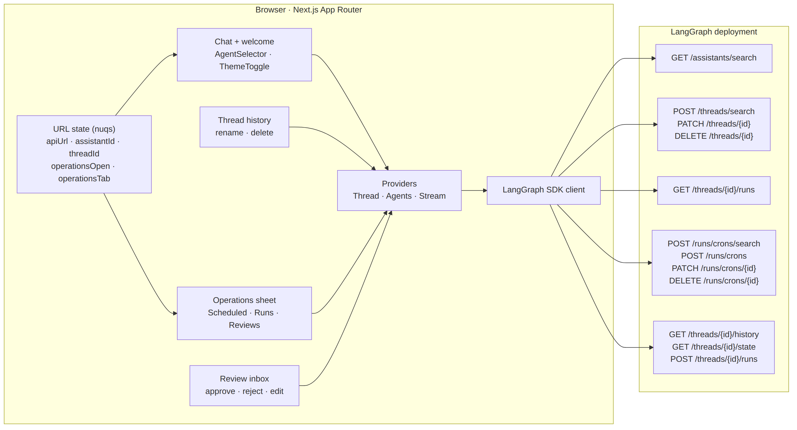
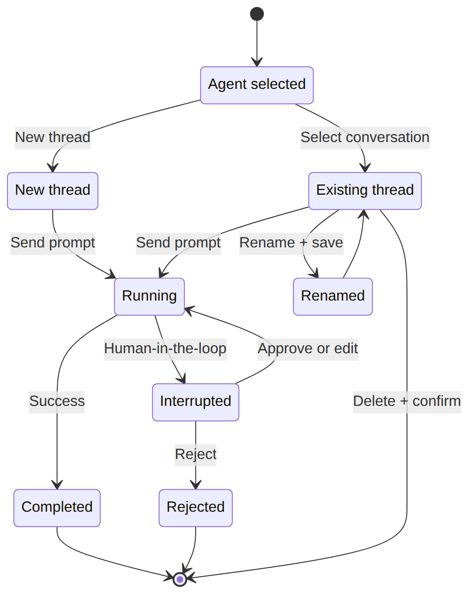
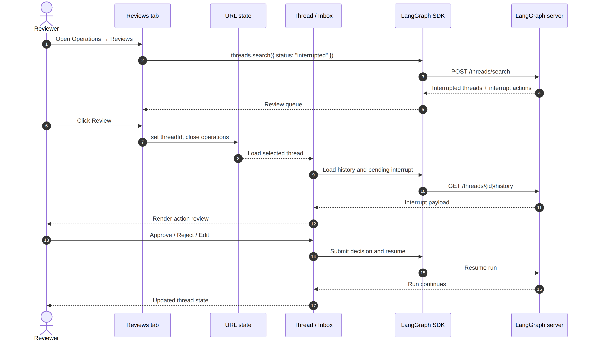
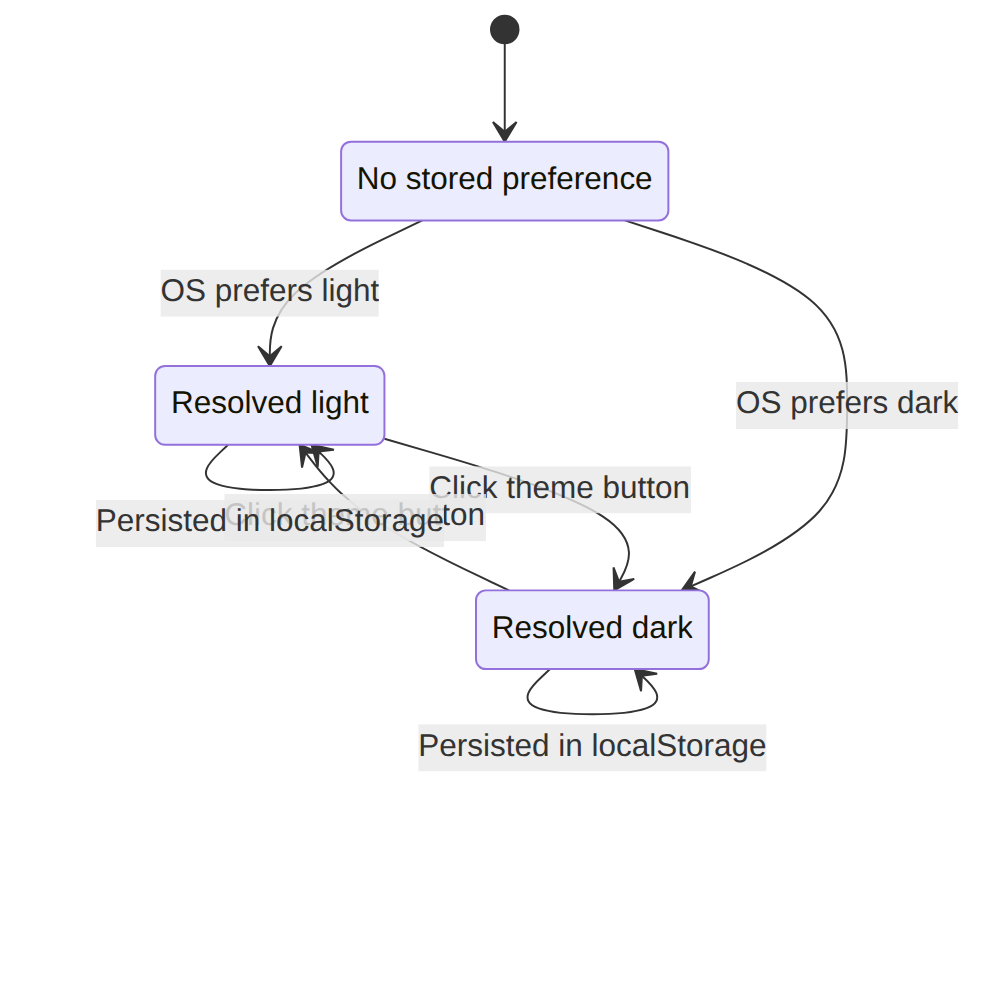
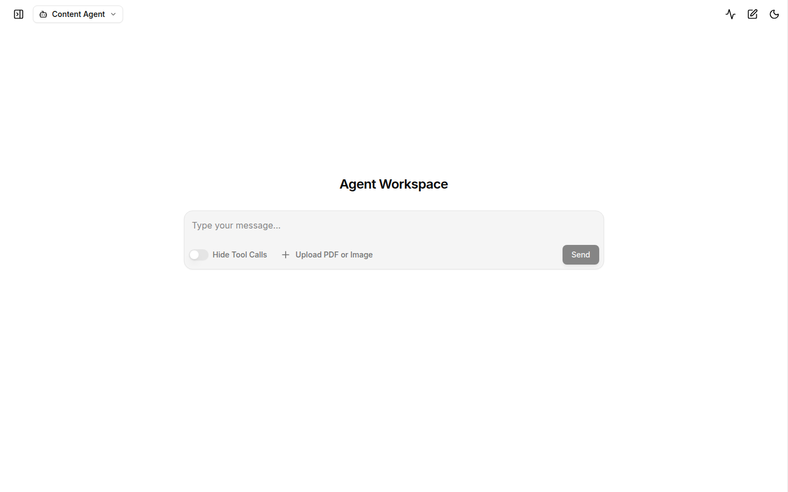
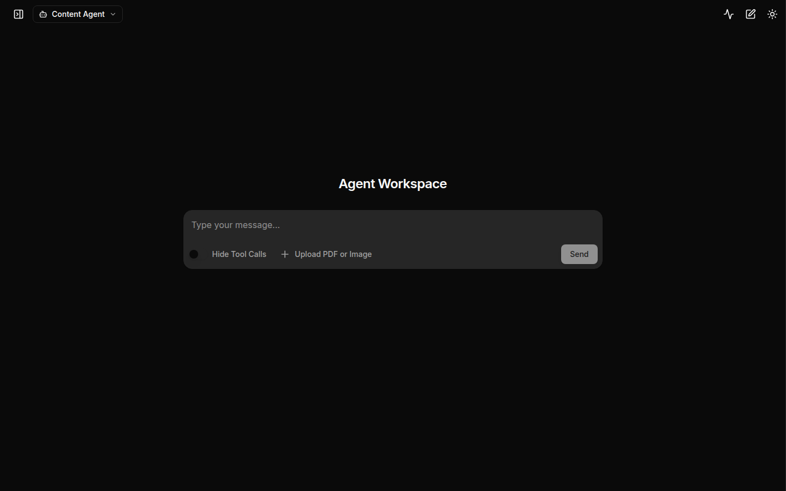

# Design: Agent Workspace

Status: implemented  
Last updated: 2026-10-26  
Inputs: [intent.md](./intent.md)  
Next artifact: [plan.md](./plan.md)

## 1. Summary

The workspace adds four capabilities on top of the existing LangGraph chat UI:

1. an agent selector backed by the deployment's assistants;
2. conversation controls (inline rename, delete with confirmation);
3. an operations sheet with Scheduled, Runs, and Reviews tabs;
4. light and dark themes with a persistent toggle.

The design keeps the existing streaming and human-in-the-loop behavior. Reviews hand off to the existing agent-inbox `ThreadView`; the new tab is a discovery surface, not a second approval implementation.

## 2. Architecture

<picture>
  <source media="(prefers-color-scheme: dark)" srcset="./images/architecture-dark.png">
  
</picture>

Diagram source: [diagrams/architecture.mmd](./diagrams/architecture.mmd)

### Component responsibilities

| Layer           | Component                                                                                      | Responsibility                                                                               |
| --------------- | ---------------------------------------------------------------------------------------------- | -------------------------------------------------------------------------------------------- |
| App shell       | `src/app/page.tsx`                                                                             | Wraps the app in `ThreadProvider` → `AgentsProvider` → `StreamProvider` → `ArtifactProvider` |
| Theme and text  | `src/app/layout.tsx`, `src/components/theme-toggle.tsx`, `src/components/font-size-toggle.tsx` | Class-based light/dark selection and Small/Default/Large text, both persisted                |
| Thread state    | `src/providers/Thread.tsx`                                                                     | Shared SDK client, thread search, refresh, rename, delete                                    |
| Agent state     | `src/providers/Agents.tsx`                                                                     | Assistant search, selection, loading and error state                                         |
| Streaming       | `src/providers/Stream.tsx`                                                                     | Remounts the stream session when the assistant changes; setup form can discover assistants   |
| Navigation      | `src/components/agents/agent-selector.tsx`                                                     | Header dropdown with refresh and selected state                                              |
| History         | `src/components/thread/history/index.tsx`                                                      | Thread list, inline rename, delete dialog, operations trigger                                |
| Operations      | `src/components/operations/index.tsx`                                                          | URL-backed sheet with Scheduled, Runs, Reviews tabs                                          |
| Scheduled       | `crons-tab.tsx`, `create-cron-dialog.tsx`                                                      | List, create, enable/pause, delete                                                           |
| Runs            | `runs-tab.tsx`                                                                                 | Recent runs across the twelve most recently updated threads                                  |
| Reviews         | `reviews-tab.tsx`                                                                              | Interrupted threads and their pending action requests                                        |
| Reviews handoff | `src/components/thread/agent-inbox/*`                                                          | Existing approve / reject / edit flow                                                        |
| Formatting      | `src/lib/threads.ts`, `src/components/operations/utils.ts`                                     | Title resolution, search metadata, relative time, interrupt extraction                       |

## 3. Navigation and URL state

`nuqs` remains the source of truth. A workspace view can be shared by URL.

| Query key         | Owner                              | Behavior                                                                           |
| ----------------- | ---------------------------------- | ---------------------------------------------------------------------------------- |
| `apiUrl`          | `StreamProvider`, `ThreadProvider` | Aegra or LangGraph-compatible deployment URL                                       |
| `assistantId`     | `AgentsProvider`, `StreamProvider` | Selected assistant UUID or graph ID                                                |
| `threadId`        | `StreamProvider`, `ThreadProvider` | Active conversation; cleared on agent switch, new thread, or current-thread delete |
| `operationsOpen`  | `OperationsSheet`                  | Opens or closes the operations sheet                                               |
| `operationsTab`   | `OperationsSheet`                  | `scheduled`, `runs`, or `reviews`                                                  |
| `chatHistoryOpen` | `ThreadHistory`                    | Desktop sidebar / mobile sheet state                                               |

Agent switch behavior:

```text
selectAgent(nextAssistantId)
  → assistantId = nextAssistantId
  → threadId = null
  → StreamSession remounts with key={assistantId}
  → thread list and operations reload for the new agent
```

The remount is deliberate. It prevents state from one graph leaking into another when schemas differ.

## 4. API surface

All calls go through the SDK client created in `ThreadProvider` and `StreamProvider`.

| User action     | SDK call                                           | Server endpoint           |
| --------------- | -------------------------------------------------- | ------------------------- |
| Load agents     | `client.assistants.search({ limit: 100 })`         | `POST /assistants/search` |
| Load threads    | `client.threads.search({ metadata, limit })`       | `POST /threads/search`    |
| Rename thread   | `client.threads.update(id, { metadata })`          | `PATCH /threads/{id}`     |
| Delete thread   | `client.threads.delete(id)`                        | `DELETE /threads/{id}`    |
| List crons      | `client.crons.search({ assistantId, limit: 100 })` | `POST /runs/crons/search` |
| Create cron     | `client.crons.create(assistantId, payload)`        | `POST /runs/crons`        |
| Toggle cron     | `client.crons.update(id, { enabled })`             | `PATCH /runs/crons/{id}`  |
| Delete cron     | `client.crons.delete(id)`                          | `DELETE /runs/crons/{id}` |
| Recent runs     | `client.runs.list(threadId, { limit: 5 })`         | `GET /threads/{id}/runs`  |
| Review queue    | `client.threads.search({ status: "interrupted" })` | `POST /threads/search`    |
| Review decision | Existing stream submit / resume path               | Thread run endpoint       |

### Thread scoping

`getThreadSearchMetadata()` treats UUID-shaped IDs as assistant IDs and everything else as graph IDs. This preserves compatibility with deployments that identify graphs by name.

### Bounded operations queries

The runs dashboard loads at most **12 threads** and at most **5 runs per thread**. This caps the N+1 request pattern at 13 calls and keeps the sheet responsive. Pagination is a follow-up, not a hidden unbounded loop.

## 5. Conversation lifecycle

<picture>
  <source media="(prefers-color-scheme: dark)" srcset="./images/thread-lifecycle-dark.png">
  
</picture>

Diagram source: [diagrams/thread-lifecycle.mmd](./diagrams/thread-lifecycle.mmd)

### Rename

- Inline edit in the thread row.
- Enter or check button saves; Escape cancels.
- Empty names are rejected client-side.
- The title is written under metadata key `title`; existing metadata is preserved.
- Display fallback order: `title` → `thread_name` → `name` → first human message → thread ID.

### Delete

- Trash icon opens a confirmation dialog showing the resolved title.
- The dialog states that messages are permanently deleted.
- Confirm calls `threads.delete`, removes the row from local state, and clears `threadId` if the deleted thread was active.
- Failure keeps the conversation and shows a toast.

### Why not soft delete?

The LangGraph SDK exposes hard deletion, and the intent is explicit cleanup. A soft-delete layer would add backend scope and is out of scope.

## 6. Operations sheet

| Tab       | Discovery                                   | Actions                       | Guardrails                                                     |
| --------- | ------------------------------------------- | ----------------------------- | -------------------------------------------------------------- |
| Scheduled | `crons.search` for selected assistant       | Create, pause/enable, delete  | Optimistic toggle with rollback; inline delete confirmation    |
| Runs      | Recent threads, then `runs.list` per thread | Filter by status, open thread | 12-thread and 5-run caps                                       |
| Reviews   | Interrupted threads                         | Open thread for review        | Hands off to existing agent-inbox; no duplicate approval logic |

The sheet is available from the welcome header, the active-chat header, and the thread sidebar. Tabs are URL-backed so a reviewer can link directly to a queue; the Reviews tab is reached through Operations. A **How to schedule jobs** button in the Operations header opens an in-product walkthrough covering cron fields, examples, timezone, end time, and safe defaults.

### Review handoff

<picture>
  <source media="(prefers-color-scheme: dark)" srcset="./images/review-flow-dark.png">
  
</picture>

Diagram source: [diagrams/review-flow.mmd](./diagrams/review-flow.mmd)

Selecting **Review** sets `threadId` and closes the sheet. The normal thread view loads the interrupt and renders the existing approval UI. This preserves separation of duties: the operations tab discovers work, the existing review surface performs it.

## 7. Theme design

<picture>
  <source media="(prefers-color-scheme: dark)" srcset="./images/theme-state-dark.png">
  
</picture>

Diagram source: [diagrams/theme-state.mmd](./diagrams/theme-state.mmd)

- `next-themes` is mounted once in `src/app/layout.tsx`.
- Configuration: `attribute="class"`, `defaultTheme="system"`, `enableSystem`, `disableTransitionOnChange`.
- `ThemeToggle` renders a moon in light mode and a sun in dark mode. It only resolves the visual icon after mount to avoid hydration mismatch.
- The toggle appears in the welcome header, active-chat header, thread sidebar, and setup form.
- Semantic tokens (`bg-background`, `text-foreground`, `bg-muted`, `border-border`, `text-muted-foreground`) replace hardcoded grays on primary surfaces.
- Markdown, tables, blockquotes, inline code, and syntax highlighting receive dark-mode overrides.
- The browser tab icon was removed; no favicon is advertised.
- `color-scheme` follows the resolved theme so native form controls match.

Theme evidence:

| Light                                     | Dark                                    |
| ----------------------------------------- | --------------------------------------- |
|  |  |

## 8. Failure handling

| Failure                  | Behavior                                                                        |
| ------------------------ | ------------------------------------------------------------------------------- |
| Assistants cannot load   | Agent selector shows an error and refresh action; graph ID fallback still works |
| Threads cannot load      | Sidebar shows an error state; retry on next refresh                             |
| Rename fails             | Inline editor remains; toast explains failure                                   |
| Delete fails             | Dialog closes only after success; thread stays in list                          |
| Cron load fails          | Tab shows retry; no destructive action is enabled                               |
| Cron toggle fails        | Optimistic state rolls back                                                     |
| Cron create/delete fails | Toast; list reloads                                                             |
| Runs partially fail      | Per-thread failures are logged and skipped; other runs render                   |
| Reviews fail             | Retry action in the tab                                                         |
| Theme mismatch           | `suppressHydrationWarning` plus mounted icon gate                               |

## 9. Security and governance

- **Human approval gate preserved.** The operations sheet cannot approve an interrupt. Approval stays in the existing agent-inbox flow.
- **Destructive confirmation.** Thread and cron deletion require a second action.
- **Least data.** The client queries only the selected agent's threads and crons.
- **No secret expansion.** Existing API key handling is untouched. No key is placed in logs or committed files.
- **Review evidence.** This design, the plan, and the review policy are versioned with the code.
- **Production rule.** If a deployment requires approval before deploys, keep that gate in branch protection and managed hooks. The UI is not the approver.

## 10. Tradeoffs and risks

| Decision / risk                     | Why                                        | Mitigation                                                             |
| ----------------------------------- | ------------------------------------------ | ---------------------------------------------------------------------- |
| Agent switch clears the thread      | Avoid cross-graph state leakage            | URL preserves the selected agent; new thread is explicit               |
| Runs dashboard is an N+1 fan-out    | SDK has no cross-thread run listing        | Cap at 12 threads and 5 runs; follow-up pagination                     |
| Reviews discovered by status search | Uses supported SDK query                   | Server-side status filtering; limit 50                                 |
| Cron title stored in metadata       | No first-class title field on cron payload | Fallback to prompt then cron ID                                        |
| Dark mode changes many classes      | Existing UI used hardcoded grays           | Semantic tokens plus contrast checks                                   |
| No committed browser tests yet      | Existing repo has no E2E suite             | Smoke procedure and eval plan in [testing.md](./testing.md)            |
| Favicon removed                     | Branding request                           | Browser shows no project icon; restore a designed icon later if needed |

## 11. Measurement

Track these with the workspace in production:

- agent selection → first message sent;
- operations opened → review opened;
- review opened → decision submitted;
- cron toggle success rate and rollback count;
- delete confirmations vs. completed deletes;
- theme toggles and contrast issue reports;
- requests per operations open (target: bounded by 13 for runs).

## 12. Open follow-ups

- Add pagination or server-side run filtering for large workspaces.
- Add agent-scoped permissions before exposing operations to broader audiences.
- Add committed Playwright coverage for the flows in [testing.md](./testing.md).
